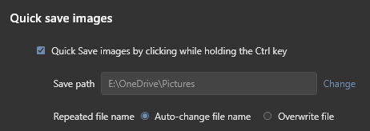

# Quick Save Images (Ctrl + Click)

> **Save any image from the web with a single click.**  
> Hold **Ctrl** and **left-click** any image — it saves straight into your folder instantly, without annoying "Save As" dialogs.

<p align="center">
  
</p>

Inspired by Maxthon's beloved quick-save feature, brought to **Vivaldi**, **Google Chrome**, and other Chromium-based browsers.

---

## ✨ Features

- ⚡ **One-Click Instant Save** — Hold `Ctrl` + click any picture. No download popups, no waiting.
- 🚫 **No Accidental Link Clicks** — Clicking an image won't open links or fullscreen lightboxes.
- 📁 **Direct to Your Folder** — Saves directly to your Windows *Pictures* folder (or any custom folder you choose).
- 🔔 **Windows Notification** — Shows a discreet notification confirming the save. Click it to jump straight to the file in File Explorer!
- 🛡️ **Works on Protected Sites** — Seamlessly grabs images from hotlink-protected sites like Pixiv, Twitter/X, and art galleries.
- 🏷️ **Smart File Naming** — Automatically detects the real image format (JPG, PNG, WebP, GIF, AVIF) and renames duplicates (`photo (1).jpg`) so you never overwrite files by mistake.

---

## 🚀 Installation (3 Simple Steps)

1. **Run `install.cmd`** in this folder (sets up the lightweight Windows helper).
2. In your browser, open `vivaldi://extensions` (or `chrome://extensions`).
3. Turn on **Developer mode** in the top-right corner, click **Load unpacked**, and choose this folder.

*You're all set! Hold `Ctrl` and click an image on any webpage to save it.*

---

## 🔒 Build from Source (Optional)

If you prefer not to run precompiled `.exe` binaries from the internet:

1. **Full Transparency**: The entire native helper is open source in a single, easily auditable file: [`host/QuickSaveHost.cs`](host/QuickSaveHost.cs).
2. **Delete the binary**: You can safely delete `host/QuickSaveHost.exe`.
3. **Automatic Compilation**: When you run `install.cmd`, it automatically builds `QuickSaveHost.exe` from scratch using the official Microsoft C# compiler (`csc.exe`) that already comes pre-installed with Windows. No extra software or SDKs needed.

*(Optional manual build command via CMD / PowerShell:)*
```cmd
%WINDIR%\Microsoft.NET\Framework64\v4.0.30319\csc.exe /nologo /target:exe /optimize+ /win32manifest:host\app.manifest /r:System.Web.Extensions.dll /r:System.Windows.Forms.dll /r:System.Drawing.dll /out:host\QuickSaveHost.exe host\QuickSaveHost.cs
```


---

## ⚙️ Settings

Click the extension icon in your browser toolbar to customize:
- **Enable/Disable** quick-save with a single checkbox.
- **Save path**: click **Change** to select your favorite downloads folder.
- **Duplicates**: choose whether to automatically number duplicate files or overwrite them.

---

## 🗑️ How to Uninstall

1. Run `uninstall.cmd`.
2. Remove the extension from `vivaldi://extensions` (or `chrome://extensions`).

---

## 📄 License

This project is completely free and released into the public domain under [The Unlicense](LICENSE).
